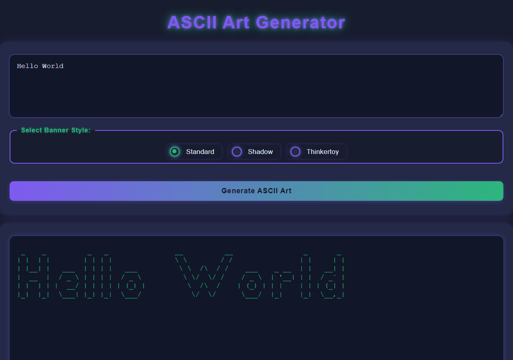
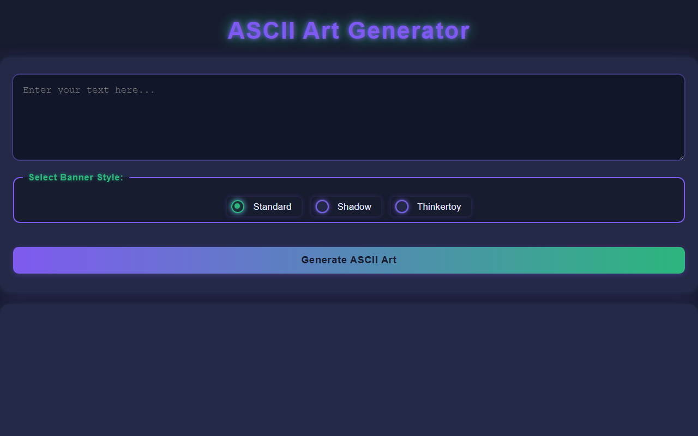

# ASCII Art Web

A Go web application that generates ASCII-art banners from text in the browser. It is built in three stages: a basic web server, a fully styled interface, and a Docker container.




## Overview

Users type text, pick a banner style and submit the form. The Go server renders the banner with the same algorithm as the [ascii-art](https://github.com/ahmed-jawher/ascii-art) CLI and returns it inside an HTML template. The project uses only the Go standard library (`net/http`, `html/template`).

## Features

- Text-to-ASCII-art conversion with three fonts: **Standard**, **Shadow** and **Thinkertoy**
- Server-side rendering with Go `html/template`
- Input validation with proper HTTP status codes
- Custom error pages for `400`, `403`/`404` and `500`
- Responsive dark UI with a gradient action button and glow effects
- Containerized with Docker for a one-command setup

## Project Stages

| Stage | Folder | What it adds |
|---|---|---|
| **1. Web** | [`/`](.) | HTTP server, `GET /` form and `POST /ascii-art` endpoint |
| **2. Stylize** | [`ascii-art-web-stylize/`](ascii-art-web-stylize) | Polished, responsive interface and refined error pages |
| **3. Dockerize** | [`ascii-art-web-dockerize/`](ascii-art-web-dockerize) | Restructured code (`internal/`), Dockerfile and container setup |

## Getting Started

**Requirements:** Go 1.20 or newer (or Docker for stage 3)

```bash
git clone https://github.com/ahmed-jawher/ascii-art-web.git
cd ascii-art-web
go run main.go
```

Open <http://localhost:8080> in your browser.

To run a later stage, change into its folder first, for example `cd ascii-art-web-stylize && go run main.go`.

### Run with Docker

```bash
cd ascii-art-web-dockerize
docker build -t ascii-art-web .
docker run --rm -p 8080:8080 ascii-art-web
```

## API

| Method | Route | Description |
|---|---|---|
| `GET` | `/` | Home page with the input form |
| `POST` | `/ascii-art` | Form fields `text` and `banner` (`standard`, `shadow`, `thinkertoy`); returns the rendered page |

| Status | When |
|---|---|
| `200 OK` | Banner generated successfully |
| `400 Bad Request` | Empty text, unsupported characters, invalid banner or wrong method |
| `404 Not Found` | Unknown route or missing template |
| `500 Internal Server Error` | Unexpected server failure |

## Screenshots

| Home | Result |
|---|---|
|  |  |

## Project Structure

```text
ascii-art-web/
├── main.go                    # HTTP server and handlers (stage 1)
├── banners/                   # standard, shadow, thinkertoy fonts
├── templates/                 # index and error pages
├── static/css/style.css
├── ascii-art-web-stylize/     # stage 2
└── ascii-art-web-dockerize/   # stage 3
```

## Author

**Ahmed Jawher** — [@ahmed-jawher](https://github.com/ahmed-jawher)
