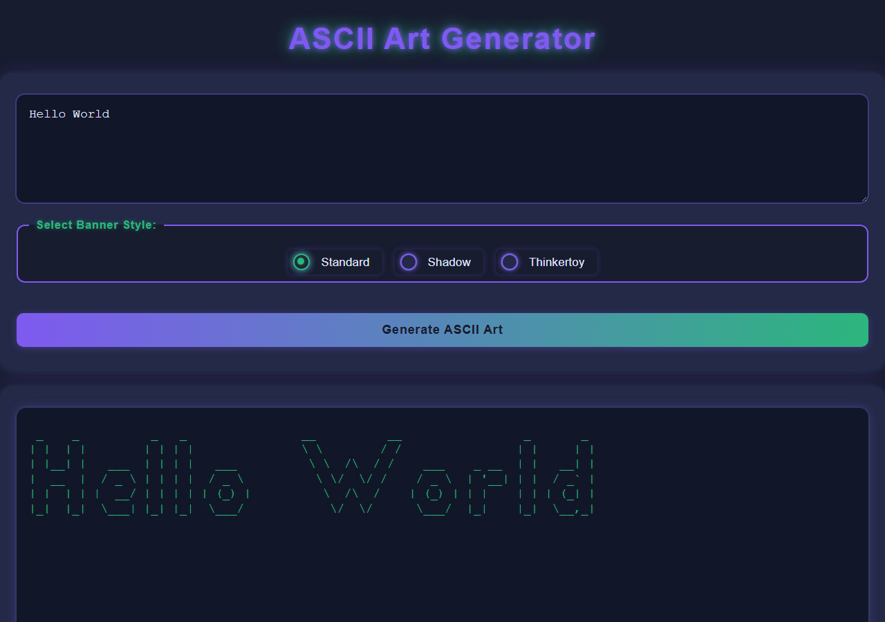

# ASCII Art Web — Stylize

Stage 2 of [ASCII Art Web](../README.md). It keeps the same Go server and adds a polished, responsive user interface.



## What's New

- Dark theme with a neon title, styled radio buttons for banner selection and a gradient submit button
- Responsive layout that works on desktop and mobile
- Styled, consistent error pages (`403`, `404`, `500`)
- The submitted text is kept in the input after generation

## Run

```bash
go run main.go
```

Then open <http://localhost:8080>.
